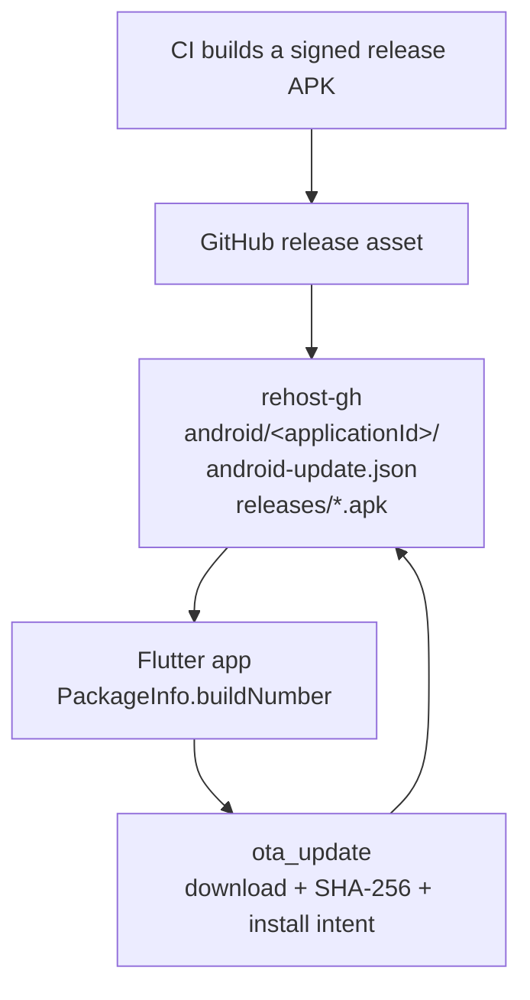

# Flutter / Android OTA updater

A sideloaded Flutter app has no Play Store update channel. The phone has to find a newer APK itself: read a public JSON file, compare `versionCode` to the installed build, download the APK, and hand it to Android's installer.

rehost-gh is the feed. Attach signed `.apk` files to a GitHub release; it republishes them as one update feed per Android application id. This document is the feed contract and a guide for a generic Flutter client.



The phone talks to the feed URL directly. It does not ask your app server whether an update exists.

## Non-goals

- **Play Store, F-Droid, or any store listing.** First install is a sideload; later versions arrive through this updater.
- **iOS.** `ota_update` has no working iOS path here.
- **Desktop auto-update.** Windows (Squirrel) and Linux package managers are separate feeds.
- **Delta or split APKs.** The feed advertises one full APK. ABI-split or app-bundle installs are out of scope.
- **Auth on the update feed.** Metadata and APKs are public. Knowing the URL is enough to download. Integrity is the SHA-256 in the metadata plus the APK signing certificate already on the device.
- **Silent / privileged install.** Ordinary sideload apps do not have `INSTALL_PACKAGES`. The user confirms the system installer dialog.

## Feed layout

One directory per application id (`package` from `AndroidManifest.xml`):

```
/android/<applicationId>/android-update.json
/android/<applicationId>/releases/<applicationId>-<versionName>+<versionCode>-<arch>.apk
```

Example, for `dev.example.app` version `1.12.34` / `3106` on arm64:

```
https://host/android/dev.example.app/android-update.json
https://host/android/dev.example.app/releases/dev.example.app-1.12.34+3106-arm64-v8a.apk
```

`android-update.json` always describes the newest kept APK. The URL never changes. Versioned APKs are immutable; older ones stay under `releases/` until retention drops them (`keep` in `rehost-gh.toml`, default 3 versions per package and architecture).

Architecture is read from `lib/<abi>/` inside the APK. A single ABI keeps that name (`arm64-v8a`, `armeabi-v7a`, `x86_64`, `x86`, …). Several ABIs become `universal`. No native libraries is `any`. When several APKs share the highest `versionCode`, the feed prefers `arm64-v8a`, then `universal`, then older ABIs.

Point the client at the metadata URL. Resolve `apkUrl` against that URL; do not hard-code APK paths.

## JSON format

`android-update.json` is the source of truth. rehost-gh writes:

```json
{
  "platform": "android",
  "versionName": "1.12.34",
  "versionCode": 3106,
  "apkUrl": "releases/dev.example.app-1.12.34+3106-arm64-v8a.apk",
  "sha256checksum": "aaaaaaaaaaaaaaaaaaaaaaaaaaaaaaaaaaaaaaaaaaaaaaaaaaaaaaaaaaaaaaaa",
  "publishedAt": "2026-05-13T20:35:00.000Z"
}
```

| Field | Rule |
|---|---|
| `platform` | Exactly `"android"` |
| `versionName` | Non-empty string; display only |
| `versionCode` | Positive integer; the only comparison key |
| `apkUrl` | Non-empty. rehost-gh writes a path relative to the metadata file. Accept an absolute `https://` URL too, and resolve a relative one against the metadata URI. |
| `sha256checksum` | SHA-256 of the APK bytes, 64 hex characters. Compare case-insensitively. |
| `publishedAt` | Parseable timestamp (`DateTime.parse` in Dart). Display / diagnostics only; do not use it to decide whether to update. |

Reject anything that fails those checks. A client that races a publish sees either the previous complete pair or the new complete pair: rehost-gh swaps the served tree atomically after the JSON and APKs are already on disk.

Relative URL example: metadata at `https://host/android/dev.example.app/android-update.json` and `apkUrl` `releases/dev.example.app-1.12.34+3106-arm64-v8a.apk` resolve to `https://host/android/dev.example.app/releases/dev.example.app-1.12.34+3106-arm64-v8a.apk`.

## Versioning

The number the updater compares is Android `versionCode`, exposed to Dart as `PackageInfo.buildNumber`.

An update is offered only when `remote.versionCode > localBuildNumber` after parsing the local build number as an integer. Equal or older remote codes are up to date. A non-numeric local build number is an error; do not offer an install.

`versionName` is what you show in the UI (`1.12.34`). How you assign `versionCode` is up to the app — git height, CI build id, or a monotonic release counter — as long as every production APK you publish has a strictly larger code than the one it should replace. Android itself also refuses a downgrade of the same package.

Flutter maps the pair as `--build-name` / `--build-number` (or `version: 1.12.34+3106` in `pubspec.yaml`). Gradle `versionName` / `versionCode` must match what you stamp on the APK, or a local release build will advertise a different code than CI.

Debug `flutter run` builds often report `1.0.0+1`. Do not let those builds check the production feed: a debug or `*.dev` application id is a different package, and a production APK cannot overwrite it (and should not be offered).

Two different application ids cannot update each other. `dev.example.app` will not replace `dev.example.other`, and a debug suffix such as `.dev` will not replace the release id.

In-place OTA also requires **the same signing certificate as the already-installed package**. Android rejects the install otherwise.

## Publishing an APK

1. Build a release APK, typically `flutter build apk --release --build-name … --build-number …`. Filter to the ABI you actually ship if you want a smaller file (`--target-platform=android-arm64` is the usual phone target).
2. Sign it with the same upload keystore as previous production builds.
3. Attach the `.apk` to a GitHub release on a repo that rehost-gh watches. The asset name can be anything that ends in `.apk`; rehost-gh reads `package`, `versionName`, `versionCode`, and ABI from the file itself.
4. After the next sync, the metadata URL updates. Clients that already point at it pick up the new `versionCode` on the next check.

You do not write `android-update.json` by hand. Do not put a local filesystem path in `apkUrl` if you generate the file yourself for tests; the client downloads whatever URL you give it.

## Client architecture

The check path is four steps:

1. `GET` the metadata URL (`Accept: application/json`).
2. Parse the JSON and resolve `apkUrl`.
3. Compare `versionCode` to `int.parse(PackageInfo.buildNumber)`.
4. If remote is newer, download that APK, verify SHA-256, start the system installer.

### Enablement

Skip the whole loop unless you are a native Android release build of the production application id:

```
enabled = isNativeAndroid && !kDebugMode && !packageName.endsWith('.dev')
```

Web, Windows, Linux, debug, and `*.dev` builds construct a disabled updater: `start()` and `checkNow()` return immediately and never fetch.

### Check loop

On first start, check once, then poll (hourly is enough; opening Settings should also call `checkNow()` so a user is not stuck waiting).

`checkNow()`:

1. Refuse if disabled.
2. Parse the local build number; fail if it is not an integer.
3. Set status to checking; clear message and progress.
4. `GET` the metadata URL (15s connect / 30s receive is plenty).
5. Parse the JSON.
6. `versionCode > local` → `updateAvailable` and keep the info; otherwise `upToDate` and drop it.
7. Any throw → `error`.

There is no need for backoff, connectivity-aware pause, or "remind me later." A failed check sits on `error` until the next poll or the next Settings open. A canceled install returns to `updateAvailable` so the Install button can fire again.

### State

```
idle
  └─ start / Settings → checking
checking
  ├─ remote > local → updateAvailable
  ├─ remote ≤ local → upToDate
  └─ throw / bad local build → error
updateAvailable
  └─ Install → installing
installing
  ├─ DOWNLOADING / INSTALLING events → installing (progress string)
  ├─ INSTALLATION_DONE → installationDone
  ├─ CANCELED → updateAvailable
  └─ plugin or start error → error
```

Prompt the user only in `updateAvailable` with a parsed update in hand. That is what both a snackbar and a Settings Install button should key off.

### Parsing

```dart
class AndroidUpdateInfo {
  const AndroidUpdateInfo({
    required this.platform,
    required this.versionName,
    required this.versionCode,
    required this.apkUri,
    required this.sha256checksum,
    required this.publishedAt,
  });

  factory AndroidUpdateInfo.fromJson(
    Map<String, dynamic> json, {
    required Uri metadataUri,
  }) {
    final platform = json['platform'];
    if (platform != 'android') {
      throw FormatException('platform must be "android", got $platform');
    }

    final apkUrl = json['apkUrl'] as String;
    final parsed = Uri.parse(apkUrl);

    return AndroidUpdateInfo(
      platform: platform,
      versionName: json['versionName'] as String,
      versionCode: json['versionCode'] as int,
      apkUri: parsed.hasScheme ? parsed : metadataUri.resolve(apkUrl),
      sha256checksum: json['sha256checksum'] as String,
      publishedAt: DateTime.parse(json['publishedAt'] as String),
    );
  }

  final String platform;
  final String versionName;
  final int versionCode;
  final Uri apkUri;
  final String sha256checksum;
  final DateTime publishedAt;
}
```

Treat a missing field, a non-integer `versionCode`, or an unparseable `publishedAt` as a failed check.

### Install

Dependency: [`ota_update`](https://pub.dev/packages/ota_update) `^7.1.0`.

```dart
OtaUpdate().execute(
  update.apkUri.toString(),
  destinationFilename: update.apkUri.pathSegments.last,
  sha256checksum: update.sha256checksum,
);
```

Leave `usePackageInstaller` false (plugin default). If the URL has no useful last path segment, fall back to `{versionName}+{versionCode}.apk`.

On the Android side the plugin:

1. Writes to `{appDataDir}/files/ota_update/{filename}`, deleting any previous file of that name.
2. Downloads with OkHttp (not `DownloadManager`), emitting `DOWNLOADING` plus a percent string.
3. SHA-256s the file and compares to the metadata checksum (case-insensitive). Mismatch → `CHECKSUM_ERROR`.
4. Builds a FileProvider URI and starts `Intent.ACTION_INSTALL_PACKAGE`.
5. Reports `INSTALLING` and **closes the event stream**.

That last point is the UX you actually get. After the system installer appears, Dart sees `INSTALLING` and then the stream ends. `INSTALLATION_DONE` is only emitted on the unused PackageInstaller path, so a successful confirm typically kills the process via the OS package replace rather than landing on "Update installed." If the user backs out of the system dialog, Flutter state often remains `installing` until the next successful `checkNow`.

Plugin errors collapse to a single install failure: already-running, installation error, permission denied, internal, download, checksum.

## Native wiring

Every app that uses this flow needs:

**`AndroidManifest.xml`**

```xml
<uses-permission android:name="android.permission.REQUEST_INSTALL_PACKAGES"/>

<application>
    <provider
        android:name="sk.fourq.otaupdate.OtaUpdateFileProvider"
        android:authorities="${applicationId}.ota_update_provider"
        android:exported="false"
        android:grantUriPermissions="true">
        <meta-data
            android:name="android.support.FILE_PROVIDER_PATHS"
            android:resource="@xml/filepaths" />
    </provider>
</application>
```

**`res/xml/filepaths.xml`**

```xml
<?xml version="1.0" encoding="utf-8"?>
<paths>
    <files-path name="internal_apk_storage" path="ota_update/"/>
</paths>
```

`ota_update` 7.x also needs `coreLibraryDesugaring` in the app Gradle file.

You do not need `InstallResultReceiver`. That receiver is only for the PackageInstaller / silent-install path.

Google Play Protect can still block a sideload. That is outside this code.

## UI

Start the poller from the app shell. Listen for a transition into "should prompt" for a **new** `versionCode` (or the first time that code is seen) and show a short snackbar:

> Update {versionName}+{versionCode} available  
> [Install]

Tapping Install starts the download. Re-emitting the same available code should not spawn a second snackbar.

Settings / About should call `checkNow()` on open and show status plus an Install button when an update is available. During download, show the plugin percent when it is non-empty (`Installing update (42%)`). Debug and `*.dev` builds can either hide the row or show that only release builds check.

## Security

What this design guarantees:

- **The APK you install is the bytes the feed hashed.** The plugin will not start the installer if SHA-256 misses. A truncated or swapped file fails closed.
- **The APK is the same app you already trust.** Android refuses the install unless the signing certificate matches the installed package.
- **A newer `versionCode` is required.** Android and the Dart check both reject downgrades and equals.

What it does not guarantee:

- **Confidentiality of the feed.** Anyone can read `android-update.json` and download APKs. That is accepted for a public sideload channel.
- **Authenticity of the JSON itself.** There is no signature on the metadata file. An attacker who can write the hosted tree (or MITM a client that does not pin TLS) can point `apkUrl` at a different APK and put that file's hash in `sha256checksum`. The phone will then install that APK **if and only if it is still signed with the existing app cert**. Compromising the host without the upload keystore can brick the feed (404 / checksum / install-rejected) but cannot push a foreign package over a healthy install.

TLS is ordinary HTTPS. There is no certificate pin.

## Failure modes

| Symptom | Likely cause | What the user sees |
|---|---|---|
| No update row, or "release builds check" | Debug build or `*.dev` package | Checks never start |
| Could not check for updates | Host unreachable, non-JSON, or parse error | `error`; next poll / Settings retries |
| Installed build number is not numeric | `PackageInfo.buildNumber` is not an int | `error`; no install |
| Check succeeds, no prompt | Remote `versionCode` ≤ installed | `upToDate` |
| Download starts then checksum error | APK bytes do not match metadata hash (partial publish, corruption, wrong file) | `error` |
| System installer refuses the APK | Signing cert mismatch, Play Protect, user denied unknown-sources | Plugin installation / permission error, or the OS dialog alone |
| Stuck on "Installing update" after backing out of the installer | Default `ACTION_INSTALL_PACKAGE` path closes the stream on `INSTALLING` | Stays `installing` until the next `checkNow` |
